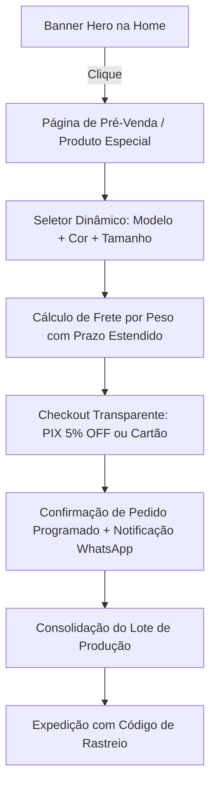

# Projeto Estratégico: Linha Fitness Canelado Sob Encomenda (Pré-Venda VIP)
**Avante Lingerie | Polo de Moda Íntima & Fitness de Nova Friburgo/RJ**

---

## 1. Visão Geral & Tese de Negócio

### 1.1 O Conceito: Capital de Giro Negativo (Risco Zero de Estoque)
A estratégia de **Venda Sob Encomenda / Fabricação sob Demanda** permite que a Avante Lingerie expanda seu portfólio para a lucrativa categoria de **Moda Fitness Canelada** sem imobilizar capital em estoque físico prévio.

* **Fluxo Financeiro:** O cliente realiza o pedido e efetua o pagamento integral (PIX com 5% de desconto ou Cartão em até 6x) com o frete calculado por peso.
* **Aquisição/Produção:** Com o caixa já realizado, os pedidos são consolidados em lotes semanais e adquiridos/retirados diretamente nos parceiros de confecção em Nova Friburgo.
* **Expedição:** As peças passam pelo controle de qualidade e expedição da Avante Lingerie, sendo enviadas com Nota Fiscal e rastreamento oficial.

---

## 2. O Produto: Conjunto Fitness Canelado Premium

### 2.1 Especificações do Tecido & Modelagem
* **Tecido:** Malha Canelada de Poliamida com Elastano (ou Suplex Canelado de Alta Gramatura).
* **Diferenciais Técnicos:**
  * Toque aveludado e suave na pele.
  * Elasticidade anatômica com alta compressão (modela cintura e quadril sem apertar).
  * **Zero Transparência:** Fator crucial de compra no segmento fitness.
  * Cós alto duplo e sustentação segura para treinos e uso casual.
* **Composição do Conjunto:**
  1. **Top Fitness:** Alças reforçadas, forro interno e entrada para bojo removível.
  2. **Calça Legging / Calça Corsário / Short Meia Coxa:** Cós chapa-barriga e costuras reforçadas em trançador.

### 2.2 Grade de Tamanhos & Cores
* **Tamanhos:** P (36-38), M (40-42), G (44), GG (46).
* **Cores Tendência:** Preto Ônix, Chumbo Mescla, Marrom Chocolate, Vinho/Bordô, Azul Petróleo, Terracota e Verde Militar.

---

## 3. Posicionamento de Comunicação & Copywriting

Para transformar o tempo de entrega em um **diferencial de valor** (e não em uma objeção de espera), a narrativa comercial adotará o conceito de **"Coleção Cápsula Sob Medida"**:

> *"Você não está esperando porque falta produto: você está pagando o menor preço do Brasil porque sua peça está sendo produzida e separada exclusivamente para você, direto do ateliê em Nova Friburgo!"*

### 3.1 Gatilhos Mentais Ativados
* **Exclusividade:** Edição limitada de pré-venda.
* **Preço de Lançamento de Fábrica:** Desconto promocional agressivo para quem garante na encomenda.
* **Transparência Total:** Prazo de envio programado explicitamente declarado antes do pagamento (7 a 10 dias úteis).

---

## 4. Arquitetura da Experiência no E-commerce (UI/UX)

### 4.1 Componentes de Interface a Desenvolver
1. **Banner Promocional na Home (`HeroSection` / `Vitrine`):**
   * Fotografia com modelos reais usando os conjuntos canelados em ambiente de academia/estúdio clean.
   * Chamada: *"Lançamento Exclusivo: Linha Fitness Canelada Direto da Fábrica — Garanta o seu na Pré-Venda Especial"*.
2. **Página de Produto com Status de "Pré-Venda Programada":**
   * Badge em destaque: `EDIÇÃO LIMITADA SOB ENCOMENDA`.
   * Seletor de cores em amostras visuais circulares.
   * Seletor de tamanhos com Tabela de Medidas interativa.
   * Botão de Ação: **`Garantir na Pré-Venda (Envio em até 10 dias úteis)`**.
3. **Cálculo de Frete Integrado:**
   * Cálculo por faixa de peso real (gramatura do conjunto ~350g a 420g) via Correios (PAC/Sedex) ou Melhor Envio.
   * O sistema exibe o prazo total: *Prazo de Produção (7 a 10 dias) + Prazo do Frete selecionado*.

---

## 5. Modelo Alternativo: Grade Fechada de Revenda (Atacado via Lia)

Para alavancar **faturamento em massa e pedidos de alto valor (R$ 300 a R$ 1.500)**, implementaremos uma esteira paralela com a **Lia (Consultora de IA no WhatsApp)**:

* **Oferta:** *"Caixa Empreendedora Fitness — Grade com 5 ou 10 Conjuntos Canelados Sortidos"*.
* **Público:** Mulheres que querem revender para colegas de treino, na academia ou no condomínio com margem de 80% a 120%.
* **Operação:** A Lia envia o PDF de catálogo com as opções de cores e grades, monta o pedido personalizado, calcula o frete especial e gera a chave PIX para faturamento imediato.

---

## 6. Checklist de Implementação Técnica

- [ ] **Fase 1 (Design & Ativos):** Produção ou curadoria de imagens de estúdio com modelos reais dos conjuntos canelados.
- [ ] **Fase 2 (Catálogo & Banco de Dados):** Cadastro da categoria `Fitness` no PocketBase com flag de `pre_order: true` e campo de `prazo_adicional_dias: 10`.
- [ ] **Fase 3 (Frontend & Checkout):** Criação do banner na Home e estilização da badge de Pré-Venda na página de produto e carrinho.
- [ ] **Fase 4 (Regra de Negócio de Frete):** Ajuste no serviço de frete para somar os dias de produção ao prazo estimado de entrega dos Correios.
- [ ] **Fase 5 (Treinamento da Lia):** Atualização da base de conhecimento da Lia no WhatsApp com os roteiros e regras da Linha Fitness.
