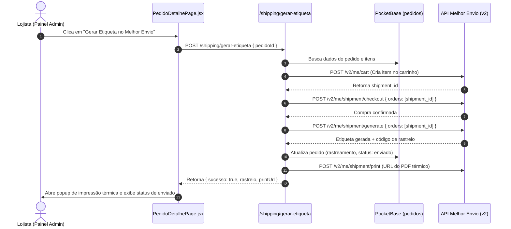

# Especificação de Funcionalidade: Geração de Etiquetas com 1 Clique (Melhor Envio)

> **Status:** Planejada / Futura  
> **Módulo:** Expedição & Logística (`apps/web` e `apps/api`)  
> **Objetivo:** Permitir a geração e impressão de etiquetas de envio diretamente pelo painel administrativo da Avante Lingerie sem necessidade de acessar o painel web do Melhor Envio.

---

## 1. Visão Geral da Funcionalidade
Atualmente, a expedição de pedidos pagos é feita gerando a etiqueta no Melhor Envio manualmente e copiando o código de rastreamento para o pedido no painel da loja.
Como a loja já possui integração autenticada com a API v2 do Melhor Envio via token (`integracoes_config`), podemos automatizar 100% desse processo com 1 único clique no painel da loja:

1. **Botão no Painel:** `[ 🏷️ Gerar Etiqueta no Melhor Envio ]`
2. **Compra do Frete:** A API da loja envia os dados do destinatário, dimensões do pacote e valor segurado para `POST https://api.melhorenvio.com/v2/me/cart`.
3. **Checkout/Pagamento:** Debita do saldo da carteira do Melhor Envio via `POST https://api.melhorenvio.com/v2/me/shipment/checkout`.
4. **Geração da Etiqueta:** Solicita a impressão da etiqueta em PDF (formato térmico 100x150mm) via `POST https://api.melhorenvio.com/v2/me/shipment/print`.
5. **Autopreenchimento:** O código de rastreamento retornado pelo Melhor Envio (ex: J&T, Jadlog, Correios) é gravado automaticamente no pedido (`rastreamento`), atualizando o status para `enviado` e disparando as notificações (E-mail VIP Resend + WhatsApp Lia).

---

## 2. Fluxo Técnico da API

---

## 3. Endpoints a Implementar no Backend (`apps/api/src/routes/shipping.js`)
- `POST /shipping/gerar-etiqueta`:
  - Recebe `{ pedidoId, serviceId }`
  - Valida saldo na carteira Melhor Envio (`GET /v2/me/balance`)
  - Cria envio no carrinho (`POST /v2/me/cart`)
  - Executa checkout com saldo (`POST /v2/me/shipment/checkout`)
  - Gera etiqueta (`POST /v2/me/shipment/generate`)
  - Salva rastreio no PocketBase
  - Retorna link da etiqueta (`POST /v2/me/shipment/print`)

---

## 4. UI no Admin (`apps/web/src/pages/admin/PedidoDetalhePage.jsx`)
- Adicionar no Card "Expedição & Rastreamento":
  - Botão de ação primária: `[ 🏷️ Gerar Etiqueta no Melhor Envio (1 Clique) ]`
  - Seletor de formato: `Etiqueta Térmica (Zebra/Elgin 100x150)` ou `Folha A4`
  - Exibição de saldo da carteira do Melhor Envio em tempo real

---

## 5. Requisitos Prévios
- Saldo suficiente na carteira do Melhor Envio.
- Chave de API ativa com escopos: `cart-read`, `cart-write`, `shipping-calculate`, `shipping-checkout`, `shipping-print`.
- Medidas e pesos dos produtos devidamente cadastrados.
