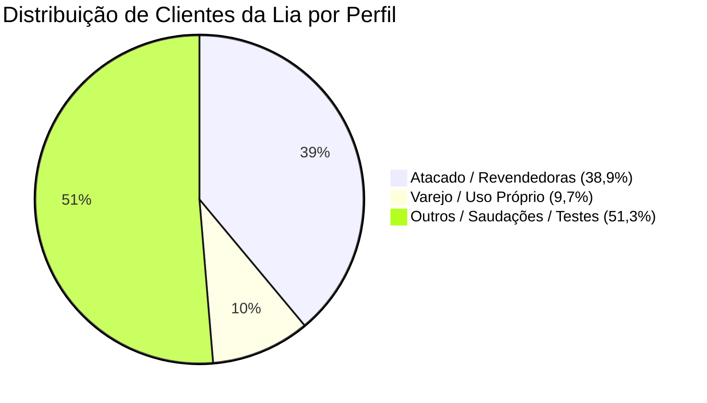
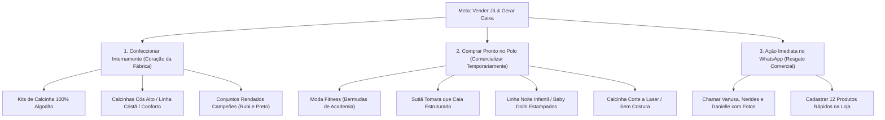

# 📊 Relatório Estratégico de Desejos dos Clientes da Avante Lingerie
### Mapeamento das Conversas Reais da Consultora Lia (`lia_conversas`)

---

## 📈 1. Radiografia das Conversas: Volume, Porcentagens e Perfis

Com base na mineração profunda de **113 atendimentos reais** armazenados no banco de dados da Lia, o comportamento dos clientes que chegam à loja e ao WhatsApp da Avante Lingerie divide-se com exatidão nas seguintes categorias:

| Categoria de Cliente | Quantidade de Atendimentos | Percentual (%) | Perfil e Intenção de Compra |
| :--- | :---: | :---: | :--- |
| **Atacado / Revenda** | **44** | **38,9%** | **Revendedoras, sacoleiras e lojistas.** Chegam pelo anúncio de fábrica querendo comprar em quantidade para lucrar de 100% a 150%. Pedem catálogo completo, fotos com preços, grade de tamanhos (P ao GG e Plus Size) e condições de frete/pagamento. Têm intenção de compras recorrentes de R$ 300,00 a mais de R$ 1.000,00. |
| **Varejo / Uso Próprio** | **11** | **9,7%** | **Consumidoras finais.** Mulheres buscando peças para o próprio corpo ou parceiros buscando presentes. Têm foco em modelos específicos de impacto visual (renda Rubi, body para sair, cropped gola alta) ou problemas de biotipo (busto grande e quadril fino). |
| **Outros / Interações Preliminares** | **58** | **51,3%** | **Interações sem intenção comercial concluída.** Inclui saudações pontuais sem continuidade (*"Oi"*, *"Boa tarde"*), dúvidas rápidas de frete/localização, curiosidade de preços genéricos, mensagens operacionais/transportadora e testes técnicos internos da equipe. |
| **TOTAL GERAL** | **113** | **100,0%** | **Base completa de conversas ativas analisadas.** |

### O Que Esse Número Revela para o Negócio?
1. **O Atacado é o Motor Principal:** Quatro em cada dez pessoas que entram em contato vieram especificamente para **REVENDA**. Isso comprova que a proposta de valor *"Fábrica de Nova Friburgo com preço de custo e margem alta"* tem forte atração comercial.
2. **A Queixa Crítica do Atacado:** Quase todas as revendedoras qualificadas reclamaram que ao entrar na loja encontraram poucas peças disponíveis (*"só vejo 2 ou 3 conjuntos"*, *"não acho sutiãs"*, *"tem pouca opção de calcinha"*). Elas estão com o dinheiro na mão, mas hesitam em fechar porque o catálogo digital ainda está enxuto.
3. **Ouro Escondido nos "Outros":** Dos 58 atendimentos classificados como outros, pelo menos 17 foram pessoas que perguntaram sobre catálogo ou deram *"Oi"* e abandonaram porque a conversa não foi imediatamente continuada no WhatsApp com fotos visuais.

---

## 👙 2. Produtos Mais Pedidos pelas Clientes (Por Ordem de Demanda)

Abaixo está o ranking exato do que os clientes mais procuraram e pediram nas conversas, separado de forma clara entre **Atacado** e **Varejo**:

### 📦 A. Ranking de Desejos no ATACADO (Revenda)

| Posição | Produto Solicitado | O Que as Revendedoras Falam | Motivo da Procura no Atacado |
| :---: | :--- | :--- | :--- |
| **1º** | **Calcinhas Básicas, Algodão e Conforto** | Pedem calcinhas 100% algodão, calcinhas de cós alto que cubram o bumbum (*"minhas clientes são cristãs, não querem fio dental"*), corte a laser sem costura e fio duplo. | É o produto de **maior giro e recompra rápida**. Nenhuma mulher compra apenas uma calcinha; as revendedoras vendem kits de 3 a 10 unidades com facilidade. |
| **2º** | **Conjuntos de Lingerie (Rendados e Básicos)** | Reclamam veementemente que a loja só tem 2 ou 3 modelos expostos. Querem conjuntos de renda sofisticados (Rubi, Preto, Romance) e conjuntos básicos para trabalhar (microfibra/algodão). | Conjunto é o item de **maior valor percebido e maior ticket médio**. A revendedora ganha R$ 40 a R$ 60 de lucro líquido por conjunto vendido. |
| **3º** | **Linha Plus Size (Tamanhos 48 ao 54)** | Procuram sutiãs reforçados com alças largas e calcinhas confortáveis de cós alto nos tamanhos 48, 50, 52 e 54. Queixam-se que o mercado e a loja costumam parar no GG/48. | **Mercado extremamente carente e fiel**. Mulheres plus size pagam o preço cobrado sem pedir desconto quando encontram uma peça que realmente sustenta e veste bem. |
| **4º** | **Linha Noite (Baby Doll Adulto/Infantil e Camisolas)** | Solicitam baby dolls para kits "mãe e filha", camisolas de manga curta sem decotes exagerados e pijamas leves. | Produto muito forte para presentes, datas comemorativas e dias quentes. |
| **5º** | **Moda Fitness (Bermudas de Academia e Tops)** | Três revendedoras perguntaram expressamente se a fábrica trabalha com moda fitness e bermudas de academia para incluir no mesmo frete de atacado. | A revendedora que vende lingerie também atende clientes em academias e caminhadas. Agregar fitness aumenta o pedido sem esforço extra. |
| **6º** | **Sutiãs Específicos (Tomara que Caia e Avulsos)** | Pedem sutiã tomara que caia reforçado (ideal para blusas de verão) e sutiãs avulsos básicos. Reclamam que não encontram sutiã avulso no site. | Muitas mulheres estragam ou têm mais sutiãs do que conjuntos completos e compram avulso com frequência. |
| **7º** | **Linha Infantojuvenil / Menina Moça** | Pedem sutiãs infantis e "menina moça" (sem bojo e sem aro) e calcinhas infantis de algodão. | Venda agregada para mães que compram para si e já abastecem as filhas. |

---

### 🛍️ B. Ranking de Desejos no VAREJO (Uso Próprio)

| Posição | Produto Solicitado | O Que as Consumidoras Falam | Motivo da Procura no Varejo |
| :---: | :--- | :--- | :--- |
| **1º** | **Conjunto Rendado Cor Rubi (Tamanho M)** | Procuram conjunto sofisticado de renda vermelha/rubi para ocasiões especiais ou autoestima. | Cor campeã de apelo emocional e atração visual imediata em anúncios. |
| **2º** | **Bodys Rendados (Outwear / Moda Balada/Casual)** | Procuram bodys rendados para usar aparentes com jeans, saia ou terninho para sair à noite. Demonstram receio se vai apertar no quadril. | Peça de altíssimo valor percebido (preço de venda alto) impulsionada pela moda feminina. |
| **3º** | **Croppeds de Gola Alta (Cores Neutras e Vinho)** | Pedem croppeds de gola alta tamanho M nas cores off-white, preto e vinho para usar no dia a dia. | Tendência de moda urbana/casual que dialoga muito bem com a confecção íntima. |
| **4º** | **Sutiãs Avulsos Grandes / Peças Desmembradas** | Cliente Cris relatou: *"Uso 48 de sutiã e 38 na calcinha. No conjunto fechado a calcinha fica imensa"*. Querem peças avulsas ou compra combinada com tamanhos diferentes. | Biotipo real da mulher brasileira (tronco largo e quadril estreito, ou quadril largo e busto pequeno). |
| **5º** | **Kits de Calcinhas Conforto** | Pedem calcinhas avulsas confortáveis e kits de cores sortidas para renovar a gaveta. | Compra utilitária e recorrente. |

---

## 👥 3. Relação Detalhada de Clientes Mapeadas (Com Contatos & Pedidos)

Abaixo estão as clientes reais extraídas da base, organizadas por canal com seus contatos diretos (WhatsApp/Telefone) e os itens exatos que conversaram com o Sr. Luiz e a Lia:

### 💼 Clientes de ATACADO (Prontas para Comprar)

#### 1. Vanusa — São Paulo / SP
* **WhatsApp:** `(11) 95937-8959`
* **Canal:** WhatsApp oficial
* **Intenção de Compra:** Primeiro pedido de teste de **R$ 300,00 a R$ 500,00** para revenda.
* **Produtos Pedidos:**
  * Conjuntos tradicionais (P, M, G, GG) e Plus Size.
  * Calcinhas de cós alto que cubram o bumbum (cor bege/nude, linha cristã/conforto — **não quer fio dental**).
  * Camisola de manga curta.
  * Moda fitness (bermudas de academia P ao GG).
* **Falas Marcantes:** *"Eu estou vendo mas só aparece 3 conjuntos, algumas calcinhas... Minhas clientes são cristãs, não gostam de fio... Quero muito ver moda fitness... Manda as fotos e valores por favor?"*
* **Status:** Quentíssima! Pediu fotos diretamente no WhatsApp com preços.

#### 2. Nerides — São Francisco de Itabapoana / RJ
* **WhatsApp:** `(22) 99905-4474`
* **Canal:** Site / WhatsApp
* **Intenção de Compra:** Revendedora experiente querendo comprar direto de fábrica.
* **Produtos Pedidos:**
  * Calcinhas 100% Algodão avulsas.
  * Calcinha dupla de algodão nos tamanhos M e G.
* **Falas Marcantes:** *"Gostaria de ver calcinhas de algodão e o valor de atacado. Compro sem CNPJ... Gostei da calça dupla totalmente de algodão, vou passar meu número: 22 99905-4474."*

#### 3. Danielle — Rio de Janeiro / RJ
* **Identificador WhatsApp:** `86659555172444@lid` (Chamou no WhatsApp particular do Luiz)
* **Canal:** WhatsApp oficial
* **Intenção de Compra:** Iniciando na revenda com foco em família e catálogo amplo.
* **Produtos Pedidos:**
  * Todos os conjuntos de calcinha e sutiã.
  * Baby doll adulto e infantil (mãe e filha).
  * Calcinhas de renda e calcinhas infantis/juvenis.
  * Sutiãs "menina moça" (sem aro/macios) e camisolas.
* **Falas Marcantes:** *"Tds conjuntos de calcinha, baby doll infantil e adulto, calcinhas de renda, calcinhas infantil e juvenil, sutiãs menina moça, camisolas tds kkk. Chamei no seu whats, vou esperar os valores."*

#### 4. Elisângela Regina Alves — Araras / SP
* **WhatsApp:** `(19) 99882-5321` | **E-mail:** `eliuniararas@gmail.com`
* **Canal:** WhatsApp oficial / Site
* **Intenção de Compra:** Revendedora atuante.
* **Produtos Pedidos:** Catálogo geral de fábrica e condições de atacado (pagamento via boleto e PIX).

#### 5. Odete — Goiás / GO
* **WhatsApp:** `(62) 99138-2008`
* **Canal:** Site
* **Intenção de Compra:** Revendedora querendo contato comercial imediato.
* **Falas Marcantes:** *"Pode me chamar no WhatsApp 62991382008 Odete. Me chama no WhatsApp nesse número, quero revender."*

#### 6. Ingrid Cunha do Prado — Rio de Janeiro / RJ
* **Identificador WhatsApp:** `79559991021760@lid`
* **Canal:** WhatsApp oficial
* **Intenção de Compra:** Revendedora abastecendo clientela exigente.
* **Produtos Pedidos:**
  * Calcinhas sem costura (corte a laser) e calcinhas fio duplo, tamanhos M e G.
  * Sutiãs avulsos.
* **Falas Marcantes:** *"Tem outras calcinhas sem essas calçolas? Sem costura e fio duplo seria para minha cliente, M e G. E sutiãs, vocês têm opções? Não acho sutiã no site."*

#### 7. Revendedora de Orlândia / SP
* **Identificador WhatsApp:** `109007421182200@lid`
* **Canal:** WhatsApp oficial
* **Intenção de Compra:** Revendedora experiente.
* **Produtos Pedidos:**
  * Sutiã tomara que caia.
  * Calcinha corte a laser.
  * Bermuda de academia (moda fitness).
* **Falas Marcantes:** *"Procuro sutiã tomara q caia, calcinha laser e bermuda de academia. Qual o mínimo de compras?"*

#### 8. Grace — Juiz de Fora / MG
* **Identificador WhatsApp:** `254288253194367@lid`
* **Canal:** WhatsApp oficial
* **Intenção de Compra:** Revendedora tradicional de Minas Gerais.
* **Produtos Pedidos:** Conjuntos rendados, conjuntos básicos e peças avulsas. Perguntou frete e possibilidade de retirada física em Friburgo.

#### 9. Revendedora da Zona Norte — Rio de Janeiro / RJ
* **Identificador WhatsApp:** `97131322933267@lid`
* **Canal:** WhatsApp oficial
* **Intenção de Compra:** Lojista de sapatos e bolsas de couro expandindo para lingerie premium.
* **Produtos Pedidos:** Grade ampla de conjuntos de lingerie sofisticados.
* **Falas Marcantes:** *"Porém de conjunto de lingerie só aparece dois modelos pra mim. É somente o que tem?"*

#### 10. Dalva — Mangaratiba / RJ
* **Identificador WhatsApp:** `184322967490791@lid`
* **Canal:** WhatsApp oficial
* **Produtos Pedidos:** Calcinhas confortáveis para o dia a dia. Reclamou de pouca variedade no site.

#### 11. Sandra — São Paulo / SP
* **Identificador Site:** `1f68e0a8-b570-4f81-8152-321115bb997e`
* **Produtos Pedidos:** Calcinhas em atacado para revenda em SP.

#### 12. Elisete — Caxias do Sul / RS
* **Identificador Site:** `226fc0c9-9529-4560-843a-7db0a213e4b3`
* **Produtos Pedidos:** Calcinhas e conjuntos de fábrica. Questionou se a loja tem mais peças para mostrar.

#### 13. Taimara — Nova Friburgo / RJ
* **Identificador Site:** `fa5c5b75-926f-40e1-85db-11f4400e23fa`
* **Produtos Pedidos:** Atacado de calcinhas para revenda local.

---

### 🛍️ Clientes de VAREJO (Consumo Próprio)

| Cliente | Canal / Contato | Produtos e Desejos Expressos |
| :--- | :---: | :--- |
| **Cris** | Site | **Sutiã Reforçado Tam. 48 + Calcinha M (38):** *"Uso 48 de sutiã e na calcinha tamanho médio (38). O sutiã pode ficar bom, mas a calcinha vai ficar imensa."* Busca compra desmembrada. |
| **Lu** | Site | **Conjunto de Renda Rubi M:** *"Procuro conjunto quais tem na coleção? Renda, M, Rubi... Calcinha, Pijama Longo Preto."* |
| **Cliente Body Rendado** | Site | **Body de Renda Preto/Vinho:** *"Oi, estou procurando um body rendado, você tem? Gostei do body, mas tenho muito medo de comprar e o tamanho ficar apertado. Sutiã G e calça 40."* |
| **Cliente Cropped** | Site | **Cropped Gola Alta M:** *"Gostaria de ver cropped gola alta M, cores neutras... vinho."* |
| **Dooner** | Site | **Conjuntos de Lingerie Avulsos:** Compra direta no site. |

---

## 🏭 4. Resumo Estratégico: "O Melhor Caminho para Se Ajeitar e Vender Já"

> **Premissa do Luiz:**  
> *"Somos confecção, estamos começando no digital agora, temos muitos produtos para subir e ainda não temos alguns produtos para confeccionar imediatamente aqui. A ideia é se ajeitar para vender: precisamos vender!"*

Para transformar essas 44 revendedoras em faturamento real e dinheiro no caixa esta semana, sem sobrecarregar a produção da fábrica, o plano de ação divide-se em 3 frentes pragmáticas:

---

### Frente 1: O Que Confeccionar na Própria Fábrica (Prioridade Máxima de Corte e Costura)
Focar estritamente no que a Avante tem domínio técnico, melhor rendimento de tecido e maior velocidade de máquina:

1. **Kits de Calcinhas Básicas 100% Algodão e Calcinhas Duplas:**
   * **Por quê:** Nerides, Vanusa, Sandra e Ingrid pediram isso com insistência. O custo de produção em Friburgo é baixo (retalhos/malha de algodão com elastano), a costura é rápida e o giro é imediato.
   * **Como vender:** Kits com 3, 5 ou 10 unidades em embalagens simples transparentes. Margem líquida excelente.
2. **Calcinha Cós Alto / "Cobre Bumbum" (Linha Cristã / Conforto):**
   * **Por quê:** A Vanusa (revendedora de SP) deixou claro que **não vende fio dental** para o público evangélico e mulheres tradicionais. Essa calcinha tem modelagem mais alta, segura a barriguinha e abraça as laterais.
   * **Como vender:** Cores neutras indispensáveis: **Bege/Nude, Preto, Branco e Romance**.
3. **Conjuntos Rendados Sofisticados (2 a 3 Modelos Campeões):**
   * **Por quê:** O conjunto de renda nas cores **Rubi (Vermelho), Preto e Vinho** é o carro-chefe que enche os olhos. 
   * **Ajuste comercial:** Manter a grade P, M, G, GG e adicionar o tamanho 48 (Plus inicial).

---

### Frente 2: O Que Comprar Pronto no Polo de Nova Friburgo (Para Revender Já e Não Perder Pedidos)
Como a Avante está sediada no **maior polo de moda íntima do Brasil (Nova Friburgo)**, não faz nenhum sentido perder uma venda de atacado de R$ 500,00 só porque a confecção não costura aquela peça específica hoje. Compre no atacado a preço de fabricante vizinho e revenda com margem saudável:

1. **Moda Fitness (Bermudas de Academia & Tops Suplex):**
   * **Por quê:** Vanusa, Daniele e a revendedora de Orlândia pediram fitness. Não vale a pena parar as máquinas de lingerie para regular ponto de agulha e trocar fio para costurar suplex pesado.
   * **Ação:** Comprar 15 a 20 bermudas de suplex básicas nos vizinhos de Olaria/Conselheiro Paulino a preço de atacado e revender para as clientes que pediram.
2. **Sutiã Tomara que Caia com Bojo Estruturado e Barbatana:**
   * **Por quê:** Exige bojo pré-moldado específico, barbatana lateral e elástico de silicone antiderrapante. Se a confecção não estiver com esse molde pronto na mesa, compre pronto no polo e coloque sua etiqueta ou revenda direto.
3. **Baby Dolls Infantis e Camisolas Estampadas (Linha Noite):**
   * **Por quê:** Danielle e Vanusa pediram linha infantil e camisola de manga curta. Em Friburgo existem dezenas de confecções especializadas apenas em liganete e malha PV infantil com preços a partir de R$ 12 a R$ 15. Compre pronto para montar o mix completo de revenda.
4. **Calcinhas Corte a Laser (Sem Costura):**
   * **Por quê:** Exige máquina de corte por ultrassom e colagem térmica que muitas confecções não têm internamente. Compre kits prontos no atacado local para atender revendedoras como Ingrid e a cliente de Orlândia.

---

### Frente 3: Plano de Choque para os Próximos 3 Dias (Vendas Imediatas)

#### Passo 1 — Abordagem Ativa no WhatsApp (Hoje Mesmo)
O Sr. Luiz Machado deve mandar mensagem personalizada no WhatsApp direto das revendedoras quentes:
* **Para a Vanusa `(11) 95937-8959`:**  
  > *"Olá Vanusa, boa tarde! Aqui é o Luiz Machado da Avante Lingerie. Conforme conversamos, separei as fotos dos conjuntos e das calcinhas de cós alto que não são fio dental (linha conforto/cristã), além das fotos das bermudas fitness. Vou te mandar aqui no WhatsApp para você escolher as peças do seu pedido de teste de R$ 300!"*
* **Para a Nerides `(22) 99905-4474`:**  
  > *"Oi Nerides, boa tarde! Aqui é o Luiz da Avante Lingerie. Estou com a grade pronta das calcinhas 100% algodão e calcinha dupla nos tamanhos M e G que você pediu. Posso te enviar as cores e os preços de atacado direto de fábrica?"*
* **Para a Elisângela `(19) 99882-5321` e Odete `(62) 99138-2008`:**  
  > Enviar o catálogo em PDF / fotos no WhatsApp com as condições de atacado.

#### Passo 2 — Resolver a Objeção de "Loja Vazia" (Em 48 Horas)
* Fotografar 10 a 15 produtos que já existem prontos no estoque da fábrica (mesmo que seja em manequim simples ou fundo branco limpo no celular).
* Subir os produtos no painel da loja com títulos diretos:
  * *Conjunto de Renda Rubi Luxo*
  * *Kit 5 Calcinhas 100% Algodão Conforto*
  * *Calcinha Cós Alto Cobre Bumbum (Linha Conforto)*
  * *Sutiã Reforçado Plus Size 48 ao 52*
  * *Bermuda de Academia Fitness Suplex*
* Isso elimina na hora a queixa das revendedoras de que *"só tem 2 conjuntos na vitrine"*.

---

## 🏆 Conclusão & Próximo Passo Prático
O mercado já validou o seu negócio: as clientes estão vindo, querem revender e já disseram exatamente o que querem comprar. Com a combinação de **produzir o básico de alto giro** e **comprar no polo o que falta no curto prazo**, a Avante Lingerie tem plenas condições de fechar os primeiros pedidos de atacado ainda esta semana!
